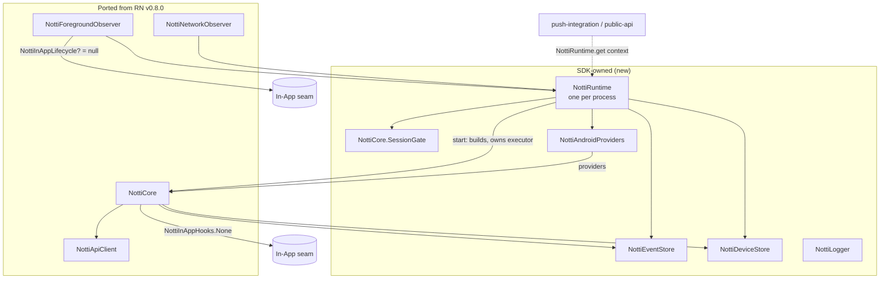

# Core Port Design

**Spec**: `.specs/features/core-port/spec.md`
**Status**: Draft (2026-10-28)
**Depends on**: `package-foundation` (module, `NottiSdkVersion`, test infrastructure, guards)

---

## Architecture Overview

Two moves, nothing else:

1. Copy the six RN core files and their tests into `com.zeeplabs.notti`, changing only the listed lines (AD-002, AD-009).
2. Replace what `NottiModule` did for the core (companion statics, executors, platform readers, logger lambda) with SDK code: one process container `NottiRuntime`, one providers class `NottiAndroidProviders`, one `NottiLogger`.

Cold-start invariant (CORE-04): `NottiRuntime.get(context)` creates the runtime lazily on the first touch from any side (process hook, FCM service, click detection, `initialize`). Its event store, gate and device store exist before any core. `enqueueEvent` persists first, then asks the live core (if any) to flush, exactly RN's `NottiModule.enqueueEvent`.

---

## RN coupling map

| RN (v0.8.0) | Purpose | Here |
| --- | --- | --- |
| `NottiModule.activeCore` | Observers and detection sites reach the live core | `NottiRuntime.core` (`@Volatile`, set by `start`, cleared by `stop(core)` only if it is still the same instance) |
| `NottiModule.processSessionGate` | One session per foreground across core re-creation | `NottiRuntime.sessionGate` (`val`) |
| `NottiModule.eventStore` + `eventStoreContext` + `getEventStore(context)` | Cold-start event persistence | `NottiRuntime.eventStore` (`val`, built from the Application context in the runtime constructor) |
| `NottiModule.enqueueEvent` | Detection-site entry | `NottiRuntime.enqueueEvent(notificationId, deliveryId, type)` |
| `NottiModule.activeInstance`, emitters, `getInitialNotificationClick` | JS events | `public-api` / `push-integration` (not here) |
| `ioExecutor` / `geoExecutor` (module fields, shut down on `invalidate`) | Core work / geocoding | `start` creates a `notti-io` executor per core (as one module = one executor in RN); a replaced core's executor is shut down, like an RN reload. `notti-geo` is one per runtime |
| `logger = { Log.e(NAME, it) }` | Core log sink | `logger = { NottiLogger.error(it) }` |
| `read*`, `hasLocationPermission`, `resolveCountry`, `fetchFcmToken` (private module funs) | Providers | `NottiAndroidProviders` |
| `requestNativePermission` (needs `PermissionAwareActivity`) | Permission dialog | Injected into `start` as `permissionRequester`; default `{ cb -> cb(false) }` until `push-integration` |
| `reactApplicationContext.currentActivity` (rationale read) | Permission status on API 33+ | `currentActivity: () -> Activity?` injected into the providers; default `{ null }` until `push-integration` wires its tracker |
| `NottiInApp.coreHooks` | Core → In-App | `NottiInAppHooks.None` (seam kept) |
| `NottiInApp.get()` in observers | Observers → In-App | `NottiRuntime.inAppLifecycle: NottiInAppLifecycle?` (null until `in-app-messages`) |

Parity note: with `currentActivity` null and no earlier request, `mapPermissionStatus` gets `shouldShowRationale = null` on API 33+, which RN maps to omitting `permission_status` (RN does the same when no Activity is resumed). Full parity returns when `push-integration` injects its Activity tracker; recorded as a cross-feature item.

---

## Code Reuse Analysis

| Component | RN source (tag `v0.8.0`) | How |
| --- | --- | --- |
| `NottiCore` (+ `SessionGate`, companion helpers) | `android/src/main/java/com/notti/NottiCore.kt` | Port; allowed changes below |
| `NottiApiClient` | `NottiApiClient.kt` | Port |
| `NottiDeviceStore` | `NottiDeviceStore.kt` | Port |
| `NottiEventStore`, `NottiEventType`, `PendingEvent` | `NottiEventStore.kt` | Port |
| `NottiNetworkObserver` | `NottiNetworkObserver.kt` | Port; default callback → runtime |
| `NottiForegroundObserver` | bottom of `NottiInitProvider.kt` | Moved to its own file; providers → runtime |
| `NottiInAppHooks` (+ `None`) | `NottiInAppCoordinator.kt:45` | Extracted to its own file, unchanged |
| `NottiInAppModels` (`InAppMessage`, `parseEligibleResponse`, `parseHexColor`, …) | `NottiInAppModels.kt` | Port with `NottiInAppModelsTest` (36): `NottiApiClient` returns these types (amendment, below) |
| `NottiInAppEventStore` (`InAppPendingEvent`, `InAppEventType`) | `NottiInAppEventStore.kt` | Port with `NottiInAppEventStoreTest` (13): `NottiApiClient.reportInAppEvent` takes these types; key `notti_pending_inapp_events` |
| Provider bodies | `NottiModule.kt` (`readAppVersion` … `fetchFcmToken`) | Moved into `NottiAndroidProviders`, bodies verbatim except `reactApplicationContext` → `context` and the log line |
| Tests | `android/src/test/java/com/notti/{NottiCore,NottiApiClient,NottiDeviceStore,NottiEventStore,NottiForegroundObserver,NottiNetworkObserver}Test.kt` | Port 1:1; `NottiModule.*` statics in tests → an isolated `NottiRuntime` |
| Process | iOS `core-port` (NottiRuntime, logger sentinel test, fixture continuity test) | Same shapes |

### Allowed changes in ported files (every other line identical under `diff -w`)

1. Provenance header comment: `// Ported from react-native-notti v0.8.0 (291d5a7): android/src/main/java/com/notti/<File>.kt`.
2. `package com.notti` → `package com.zeeplabs.notti`; imports of RN types removed.
3. Visibility: top-level `class`/`object`/`fun` become `internal` (ABI dump stays empty, AD-010).
4. Re-indent 2 → 4 spaces (AD-009); `spotlessApply` formatting only.
5. Exception messages never reach a log line (AD-011; iOS logs `domain#code` for the same reason): `Log.e(NottiModule.NAME, "… - ${t.message}")` → `NottiLogger.error("… - ${t.javaClass.simpleName}")`; in `NottiCore`, the three `logger("… - ${t.message}")` lines use `${t.javaClass.simpleName}`; in `NottiApiClient`, `lastError = e.message ?: "network error"` becomes `lastError = e.javaClass.simpleName` (that string only feeds `ApiResult.Failure.message`, which the core only logs; no RN test asserts it). Amended 2026-10-28 after T4 found the core's `logger` lines carry `result.message` from OkHttp exceptions.
6. `NottiModule.activeCore` / `processSessionGate` / `NottiInApp.get()` references → runtime / seam, in the two observers only.
7. KDoc references to `NottiModule` rewritten to the runtime (comments only).
8. Per-file `@file:Suppress(...)` only for lint/ktlint findings that fire on unchanged RN code.

Any other change needs a `SPEC_DEVIATION` note in the task and in `traceability.md`.

---

## Components

### NottiRuntime (new)

- **Purpose**: The one process-wide owner of the core's shared state; replaces the `NottiModule` companion.
- **Location**: `notti/src/main/java/com/zeeplabs/notti/NottiRuntime.kt`
- **Interfaces**:
  - `companion fun get(context: Context): NottiRuntime` — lazy, double-checked, keeps only `applicationContext`
  - `companion fun peek(): NottiRuntime?` — for observers that must not create it
  - `val sessionGate: NottiCore.SessionGate`, `val eventStore: NottiEventStore`, `val deviceStore: NottiDeviceStore`
  - `@Volatile var core: NottiCore?` (private set)
  - `@Volatile var inAppLifecycle: NottiInAppLifecycle?` (null until `in-app-messages`)
  - `fun start(appId: String, clientKey: String, baseUrl: String, permissionRequester: (callback: (Boolean) -> Unit) -> Unit = { it(false) }, onDeviceIdChanged: (String) -> Unit = {}): NottiCore` — builds a core with the real providers, a new `notti-io` executor, the shared gate, `NottiInAppHooks.None` and `logger = NottiLogger::error`; sets `core`; calls `NottiForegroundObserver.onCoreCreated`; calls `core.initialize(appId, clientKey, baseUrl, NottiSdkVersion.CURRENT)`. Replacing a live core shuts the old core's executor down (RN reload semantics). Config comparison / no-op rules belong to `public-api`.
  - `fun stop(core: NottiCore)` — clears `core` only when it is the same instance; shuts its executor down
  - `fun enqueueEvent(notificationId: String, deliveryId: String, type: String)` — `eventStore.enqueue`, then `core?.onNetworkAvailable()`
  - `internal constructor(context, prefs, providers, executorFactory, clock)` for tests; `companion fun resetForTest()`
- **Prefs**: `context.getSharedPreferences(PREFS_NAME, MODE_PRIVATE)`, `PREFS_NAME = "notti_prefs"` (golden test).
- **Reuses**: RN `NottiModule` companion and constructor wiring (lines 36-212, 558-689).

### NottiAndroidProviders (new file, RN bodies)

- **Purpose**: Android readers the core needs (CORE-06..08).
- **Location**: `notti/src/main/java/com/zeeplabs/notti/NottiAndroidProviders.kt`
- **Interfaces** (each RN body moved verbatim):
  - `appVersion(): String?`, `deviceOs(): String?`, `deviceModel(): String?`, `timezoneId(): String?`, `language(): String?`
  - `permissionStatus(callback: (String?) -> Unit)` (uses `deviceStore.getPermissionRequested()` and `currentActivity()`)
  - `hasLocationPermission(): Boolean`
  - `country(callback: (String?) -> Unit)` (on the runtime's `notti-geo` executor, `RejectedExecutionException` → null)
  - `fcmToken(callback: (String?) -> Unit)` (success/failure listeners on the core's `notti-io` executor, any exception → null)
- **Constructor**: `(context, deviceStore, currentActivity: () -> Activity?, geoExecutor, firebaseToken: () -> Task<String> = { FirebaseMessaging.getInstance().token })` — the Firebase seam lets tests drive success, failure and a throwing `getInstance()` (no FCM configured, SDK-04).
- **Tests** (new, Robolectric `@Config(sdk = [34])` plus `[32]` where the branch depends on API level): one class `NottiAndroidProvidersTest`, cases per reader incl. failure → null; permission status on API 32 vs 34, rationale null/true/false; location check fine/coarse/none; country with no last location, geocoder failure and shut executor; FCM success/failure/throw.

### NottiLogger (new)

- **Purpose**: The single log sink (CORE-15/16).
- **Location**: `notti/src/main/java/com/zeeplabs/notti/NottiLogger.kt`
- **Interfaces**: `enum class Level { VERBOSE, DEBUG, INFO, WARN, ERROR, NONE }`; `@Volatile var level = Level.ERROR`; `@Volatile var sink: (Level, String) -> Unit` (default `android.util.Log.println(priority, "Notti", message)`); `fun error(message: String)`, `warn`, `info`, `debug` with lazy `() -> String` overloads.
- `internal` now; `public-api` exposes the level only.

### NottiInAppHooks and NottiInAppLifecycle (seams)

- `NottiInAppHooks` (default no-op methods, `companion val None`): extracted verbatim from RN `NottiInAppCoordinator.kt:45`; the core keeps its two call sites (`onSessionStarted`, `onRegistered`).
- `NottiInAppLifecycle` (new, small): `onAppForegrounded()`, `onSessionEnded()`, `onAppBackgrounded()`, `onNetworkAvailable()` — the four calls the RN observers make on `NottiInAppCoordinator`. `in-app-messages` makes the coordinator implement it. The ported observer bodies call `runtime.inAppLifecycle?.…` where RN called `NottiInApp.get()?.…` (allowed change 6).

### Ported observers

- `NottiForegroundObserver` (`object`, own file): `coreProvider = { NottiRuntime.peek()?.core }`, `inAppProvider = { NottiRuntime.peek()?.inAppLifecycle }`; `onStop` passes `NottiRuntime.peek()?.sessionGate` (if no runtime exists, no session was opened, so nothing to close). Registration with `ProcessLifecycleOwner` is done by `push-integration`'s process hook.
- `NottiNetworkObserver`: default callback `{ NottiRuntime.peek()?.core?.onNetworkAvailable(); NottiRuntime.peek()?.inAppLifecycle?.onNetworkAvailable() }`; registration by the process hook.

---

## Data Models

Unchanged from RN 0.8.0 (continuity, CORE-12). Recorded here as the contract the fixture test pins:

| Key (in `notti_prefs`) | Type | Writer |
| --- | --- | --- |
| `notti_device_id`, `notti_last_token`, `notti_external_user_id`, `notti_email`, `notti_phone`, `notti_app_version`, `notti_last_synced_*` | String | `NottiDeviceStore` |
| `notti_tag_<key>` | String | `NottiDeviceStore` |
| `notti_session_count` | Int (`putInt`) | `NottiDeviceStore` |
| `notti_session_time_ms`, `*_at_ms` keys | Long | `NottiDeviceStore` (full list with defaults in `traceability.md`, Storage contract) |
| `notti_subscribed`, `notti_permission_requested`, `notti_location_sharing_enabled`, `notti_pending_*_clear`, `notti_profile_field_ack_migrated` | Boolean | `NottiDeviceStore` |
| `notti_pending_events` | String: JSON array of `{id, notificationId, deliveryId, type, createdAtMs}`, cap 32 (`MAX_PENDING_EVENTS`) | `NottiEventStore` |
| `notti_pending_inapp_events` | String: JSON array of In-App events (RN schema) | `NottiInAppEventStore`, ported here as data code; only `in-app-messages` writes to it at runtime |

Corrupt `notti_pending_events` (spec edge case): RN `all()` drops the key and returns an empty list; ported unchanged and already covered by an RN `NottiEventStoreTest` case.

---

## Amendment 2026-10-28 (found executing T4)

RN's `NottiApiClient` is not core-only: it also carries the In-App routes (`fetchEligibleInAppMessages`, `reportInAppEvent`, 13 of its 48 tests) and uses `InAppMessage`/`parseEligibleResponse` (`NottiInAppModels.kt`), `InAppPendingEvent`/`InAppEventType` (`NottiInAppEventStore.kt`) and `formatIsoUtc` (`NottiCore.kt:1368`), while `NottiCore` uses `NottiApiClient`. Decision (Claude, within the port rule; reported to Julio):

- Port the two In-App data files (pure models/parsers and the persisted queue, no UI, no engine) with their RN tests here, so `NottiApiClient` stays a verbatim port with all 48 tests. Splitting the In-App routes out of the client would change a ported file and drop 13 tests below the RN count.
- `NottiApiClient` and `NottiCore` are ported in one task and one commit (they need each other to compile).
- The In-App engine (`Session`, `Coordinator`, `Presenter`, `ViewFactory`, `Style`, `ImageLoader`, `Accessibility`, `Setup`, `PushPermissionAction`) stays in `in-app-messages`.

## Error Handling Strategy

| Error Scenario | Handling | Impact |
| --- | --- | --- |
| Provider throws or source missing | `null` (or `false` for the location check), one `NottiLogger.error` with the exception class | Field omitted; core continues |
| FCM not configured (`getInstance()` throws) | token `null` | Registration waits as RN with a null token (direct test, CORE-11) |
| Corrupt pending-event JSON | Queue dropped, empty list (RN) | Lost events, no crash loop |
| Executor shut down (replaced core) | RN `RejectedExecutionException` handling in the core | Old core's work stops |
| `NottiRuntime.get` raced from two threads | Double-checked lock; one instance | Single event store |

---

## Testing Strategy

- **Ported** (CORE-09): six RN classes, 208 tests, same names and `@Config`. `NottiModule.resetProcessWideStateForTest()` / `processSessionGate` / `activeCore` in `NottiForegroundObserverTest` → `NottiRuntime.resetForTest()` and a runtime built on a Robolectric context. Its In-App cases use a fake `NottiInAppLifecycle` here; `in-app-messages` re-adds the coordinator-backed version.
- **New**: `NottiRuntimeTest` (lazy creation, identity-guarded stop, `enqueueEvent` before any core persists and a later core flushes it, executor shut down on replace, `sdk_version` equals the constant in the registration body via MockWebServer, golden `notti_prefs`), `NottiAndroidProvidersTest`, `NottiLoggerTest` (level filter, lazy message not evaluated), `NottiContinuityTest` (RN 0.8.0 fixture: no `POST /devices` when RN would not; device id kept; tags/session/pending events/acks read back), `NottiLogPrivacyTest` (sentinel flow at `VERBOSE` with a capturing sink).
- **Guard**: CI step (added to the `checks` job) `! grep -rnE 'com\.facebook\.react|ReactApplicationContext|WritableMap|NativeNottiSpec' notti/src` with grep status 2 failing (same pattern as `check-package-name.sh`, as a new `scripts/check-no-react-native.sh` + self-test).
- **Parity check**: `scripts/port-diff.sh <rn-file> <ported-file>` (dev tool, not CI): strips the header, `package`/import lines and indentation, then `diff -w`; every remaining hunk must be one of the allowed changes. Its output summary goes into `traceability.md`.

---

## Tech Decisions

| Decision | Choice | Rationale |
| --- | --- | --- |
| Container | `NottiRuntime` class with a lazy companion instance | Mirrors iOS `NottiRuntime`; testable via `resetForTest` and an internal constructor |
| Executor per core | New `notti-io` per `start`, old one shut down | Keeps RN's "one module, one executor" semantics on re-initialize; a stuck retry of an old config cannot block the new core |
| Logger signature in the core | Keep RN's `(String) -> Unit`, wired to `NottiLogger.error` | Zero change to the core's call sites (port rule); iOS changed the signature, not needed here |
| `${t.message}` in logs | Replaced by `${t.javaClass.simpleName}` | AD-011; exception messages from OkHttp/Firebase can embed URLs |
| In-App observer seam | New `NottiInAppLifecycle` interface | Observers compile without the In-App engine; the engine plugs in later |
| Permission requester / current Activity | Injected, null defaults | Needs an Activity tracker that belongs to `push-integration` |

---

## Cross-feature items

- `push-integration`: call `NottiRuntime.get(app)` at process start, register both observers, provide `currentActivity` and `permissionRequester`, call `runtime.enqueueEvent` from the detection sites.
- `public-api`: initialize no-op/rebuild rules (AD-008), `NottiLogger` level API, device-id listener on `onDeviceIdChanged`.
- `in-app-messages`: implement `NottiInAppHooks` and `NottiInAppLifecycle`, set `runtime.inAppLifecycle`, re-add the coordinator cases of `NottiForegroundObserverTest`.
