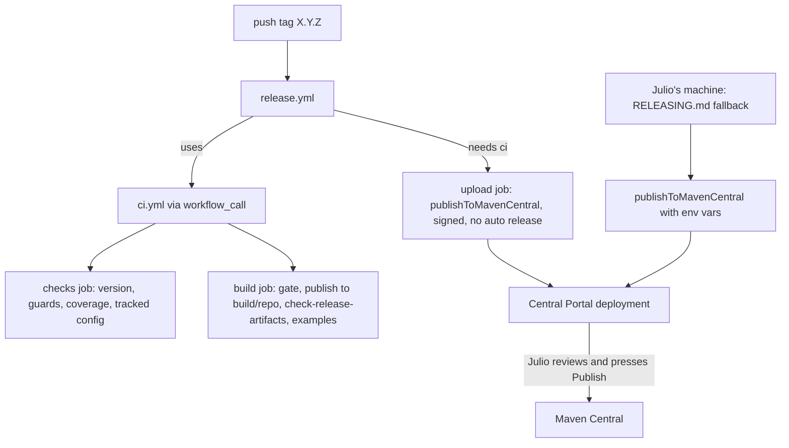

# Example App and Release 0.1.0 Design

**Spec**: `.specs/features/example-and-release/spec.md`
**Status**: Draft

---

## Architecture Overview

No SDK code changes. Four groups of work:

1. **Example**: `:example` gains local config and one screen with every public call; `:example-manual-fcm` gains the same conditional Firebase setup.
2. **Guards**: two new scripts (`check-example-coverage.sh`, `check-no-tracked-config.sh`), one release check (`check-release-artifacts.sh`), and a CI build with a synthetic `google-services.json`.
3. **Docs**: README rewrite, `docs/DEVICE_CHECKLIST.md`, `docs/RELEASING.md`, CHANGELOG `0.1.0`.
4. **Release path**: `mavenPublishing { publishToMavenCentral() }`, a fail-fast guard against an unsigned upload, `release.yml` that reuses `ci.yml`.



---

## Research notes

| Topic | Finding | Source / confidence |
| --- | --- | --- |
| vanniktech 0.37.0 upload | `publishToMavenCentral()` in the DSL; `./gradlew publishToMavenCentral` uploads without release, then "Publish" in the Portal's Deployments page. `publishAndReleaseToMavenCentral` releases automatically (not used) | Plugin docs `central/` page [Certo] |
| Credentials | `mavenCentralUsername` / `mavenCentralPassword` (Portal user token, not the login), as Gradle properties or `ORG_GRADLE_PROJECT_*` env vars | Plugin docs [Certo] |
| In-memory signing | `ORG_GRADLE_PROJECT_signingInMemoryKey` (armored private key), optional `...KeyId` and `...KeyPassword` | Plugin docs [Certo]. The current build already keys `signAllPublications()` on `signingInMemoryKey` |
| Google Services plugin under AGP 9.2.1 | `zeep-notti-react-native/example` applies `com.google.gms:google-services:4.5.0` the same conditional way on AGP 9.2.1 (AD-012 S1) | Codebase [Provável]: proved for the RN example build; T1 confirms here with a synthetic file |
| Throwaway signing key | `gpg` absent on this Mac; present on `ubuntu-24.04` runners | Local check [Certo]. RSA 3072 rather than Ed25519 to avoid depending on the signing library's EdDSA support [Provável] |

---

## Code Reuse Analysis

| Component | Location | How to use |
| --- | --- | --- |
| Example modules | `example/`, `example-manual-fcm/` | Extend; keep `-Pnotti.usePublished` wiring |
| Script self-test helpers | `scripts/tests/lib.sh`, `run.sh` | New `*-test.sh` files are picked up by `run.sh` |
| Guard style | `scripts/check-package-name.sh`, `check-no-url-open.sh` | Same shape: `[root]` argument, missing input fails, grep exit codes told apart |
| CI artifact step | `ci.yml` "AAR and POM contents" | `check-release-artifacts.sh` runs after it on the same `build/repo` |
| Publication | `notti/build.gradle.kts` `mavenPublishing {}` | Add `publishToMavenCentral()`; signing condition unchanged |
| README draft sections | `README.md` (public-api, push-integration, in-app-messages) | Reworked in place, not rewritten from scratch |
| iOS checklist and runbook | `../zeep-notti-ios-sdk/docs/DEVICE_CHECKLIST.md`, iOS `example-and-release` | Structure for item format (prerequisites, steps, expected, pass box) |

---

## Components

### D1. Example config (EXR-01, EXR-04..EXR-06; AD-016)

- `example/notti.properties.sample` (tracked):
  ```properties
  # Copy to notti.properties (git-ignored) and fill in. Never commit the real file.
  notti.appId=fixture-app-id
  notti.clientKey=fixture-client-key
  # Optional; default https://app.zeepnotti.app
  # notti.baseUrl=https://notti.example.invalid
  ```
- `example/build.gradle.kts` reads `example/notti.properties` with `java.util.Properties` when the file exists, and sets `buildConfigField("String", "NOTTI_APP_ID", …)`, `NOTTI_CLIENT_KEY`, `NOTTI_BASE_URL` (empty string when absent; values escaped). `buildFeatures { buildConfig = true }`.
- `:example-manual-fcm` reads the same file (`../example/notti.properties`) so one file configures both apps. [Provável] it has no screen today; it gets the same `Application` init (D2) without UI.
- `ExampleConfig` (example source): `isComplete` = app id and client key both non-blank and not the sample placeholders. Incomplete: no `Notti.initialize`, "Not configured: copy example/notti.properties.sample" shown.
- Google Services: root `build.gradle.kts` adds `alias(libs.plugins.google.services) apply false` (catalog `googleServices = "4.5.0"`, the RN example's version). Each example module: `if (file("google-services.json").exists()) apply(plugin = "com.google.gms.google-services")`. The library never applies it.
- `.gitignore`: `notti.properties` (anywhere). `google-services.json` is already ignored.
- Synthetic Firebase config for CI: `scripts/tests/fixtures/google-services.fixture.json` with `project_id` `notti-fixture`, `mobilesdk_app_id` `1:000000000000:android:0000000000000000`, API key `fixture`, both example package names. Named `.fixture.json` so the tracked-config guard does not match it.

### D2. Example screen (EXR-02, EXR-03)

- Plain Views, one `ScrollView` built in code (no XML layouts, as today). Sections:
  1. **Status**: config state, SDK version, device id (initial value plus `addDeviceIdChangedListener`), log level spinner (`Notti.logLevel` get/set).
  2. **Permission**: `requestPermission`, result text.
  3. **Identity**: external id field, `login`, `logout`.
  4. **User**: email field with set/clear, phone field with set/clear, tag key and value fields with `addTag`/`removeTag`, a "sample tags" pair of buttons for `addTags`/`removeTags`.
  5. **Device**: subscription switch (`setSubscription`), location sharing switch (`setLocationSharingEnabled`).
  6. **Notifications**: `takeInitialClick` button showing data keys.
  7. **In-App**: event name field plus `trackEvent`.
  8. **Event log**: last 50 lines, newest first.
- `ExampleApplication.onCreate`: log level, `addReceivedListener`, `addClickedListener`, `InAppMessages.addClickListener` (all before `initialize`, so a cold-start tap and an early In-App click are seen), then `initialize` when configured. Listeners write to `ExampleEventLog`, a main-thread in-memory list with one observer (the Activity), so events before the screen exists are kept.
- Log and screen content rule (EXR-03): notification lines show the event kind and `data.keys`; In-App lines show message id, button id and action type; identity and user lines say which call ran, never the value. Nothing goes to `android.util.Log` except through the same redacted line.
- Calls are written fully qualified (`Notti.User.setEmail(...)`, not `with(Notti.User)`), which the coverage guard (D3) relies on. Rule stated in a comment at the top of the screen file.

### D3. `scripts/check-example-coverage.sh` (EXR-02)

- Input: `notti/api/notti.api`, sources under `example*/src/main/**/*.kt` and `*.java`.
- Owners and their source prefix: `com/zeeplabs/notti/Notti` → `Notti.`, `Notti$User` → `Notti.User.`, `Notti$Notifications` → `Notti.Notifications.`, `Notti$InAppMessages` → `Notti.InAppMessages.`, `NottiBridge` → `NottiBridge.`.
- Members: every `public … fun <name>` line in the owner's block, skipping `synthetic` and `$default`. `get<X>` becomes property `<x>`; `set<X>` becomes property `<x>` when the block also has `get<X>`, else it stays the function `set<X>`. Overloads collapse.
- Pass rule: each `<prefix><member>` appears (word-bounded) in at least one example source. Fails listing the missing ones. Missing `notti.api`, an owner block not found, or no example source is an error (exit 2), distinct from "missing references" (exit 1).
- Self-test `scripts/tests/check-example-coverage-test.sh`: fixture api + sources for full coverage, a missing function, a property referenced only by its getter name, a `set` function without getter, a missing owner block, missing api file.

### D4. `scripts/check-no-tracked-config.sh` (EXR-06)

- `git -C <root> ls-files` matched against `(^|/)google-services\.json$` and `(^|/)notti\.properties$`. Any match fails and names the path. Not a git checkout fails (exit 2).
- Self-test builds a temp repo: clean, tracked `example/google-services.json`, tracked `notti.properties`, a tracked `.sample` and `.fixture.json` that must pass.

### D5. CI additions (EXR-05, EXR-20)

- `checks` job: `check-example-coverage.sh`, `check-no-tracked-config.sh` (self-tests already run through `run.sh`).
- `build` job, after the existing publish step: `scripts/check-release-artifacts.sh` (D7).
- `build` job, after the example builds: copy the fixture to `example/google-services.json`, run `:example:assembleDebug` again, assert the merged resources have `google_app_id` equal to the fixture value (proves the plugin was applied). Then remove the copy. The plain build before it proves the no-file path.

### D6. Maven Central upload wiring (EXR-16; AD-015)

- `mavenPublishing { publishToMavenCentral() }` (default `automaticRelease = false`). Configuration does not read credentials, so local and PR builds are unaffected [Provável]; T7 proves `publishAllPublicationsToBuildRepository` still runs with no credentials.
- Unsigned upload guard: `tasks.matching { it.name == "publishToMavenCentral" }.configureEach { doFirst { … } }` fails with "signingInMemoryKey is not set; refusing an unsigned upload" when the property is absent (captured as a `Provider`, configuration-cache safe). Central would reject it anyway; this fails in seconds and names the cause.

### D7. `scripts/check-release-artifacts.sh` (EXR-17)

1. Requires `gpg` (error with the install hint when missing; exit 2). Creates a temp `GNUPGHOME`, generates an RSA 3072 sign-only key with no passphrase and 1-day expiry (`Notti Release Check <release-check@example.invalid>`), exports it armored.
2. Runs `./gradlew --console=plain :notti:publishAllPublicationsToBuildRepository` with `ORG_GRADLE_PROJECT_signingInMemoryKey` set to it (and `--no-configuration-cache` only if the run shows it needs it).
3. For `aar`, `pom`, `-sources.jar`, `-javadoc.jar`, `.module`: the `.asc` exists and `gpg --verify` passes.
4. POM has non-empty `name`, `description`, `url`, `licenses/license/name`, `developers/developer/id` or `name`, `scm/url`.
5. Deletes the temp `GNUPGHOME` on exit (`trap`). Never prints the key.

- Locally it needs `brew install gnupg`, which `RELEASING.md` already needs for the real key. The agent does not install it; the TESTING.md Full gate notes the requirement.

### D8. `release.yml` (EXR-16)

- `on: push: tags: ['[0-9]+.[0-9]+.[0-9]+']`. `permissions: contents: read`. `concurrency: group: release-${{ github.ref }}, cancel-in-progress: false`.
- Job `ci`: `uses: ./.github/workflows/ci.yml` (the tag ref makes `check-version.sh` run its tag checks).
- Job `upload` (`needs: ci`, `environment: maven-central`): checkout, wrapper validation, JDK 17, setup-gradle with `cache-read-only: true`, a step that fails naming any empty secret among `MAVEN_CENTRAL_USERNAME`, `MAVEN_CENTRAL_PASSWORD`, `SIGNING_KEY`, `SIGNING_KEY_PASSWORD` (the last may be empty only if documented as optional; decision: required, the runbook generates a key with a passphrase), then `./gradlew --console=plain :notti:publishToMavenCentral` with the `ORG_GRADLE_PROJECT_*` env vars from those secrets.
- `ci.yml`: add `workflow_call:`; drop `tags` from its `push` trigger so a tag runs CI once (through `release.yml`). Its concurrency group (`${{ github.workflow }}-${{ github.ref }}`) evaluates to `Release-refs/tags/X.Y.Z` when called, distinct from `release-…`; the upload job never shares a group with it.
- The GitHub `environment` lets Julio add a required reviewer later; the secrets live in that environment, not the repository.

### D9. Docs (EXR-07..EXR-15, EXR-18, EXR-19)

- **README**: the order of EXR-07. Reworks the draft sections (Usage, Android integration) and adds: Requirements, Install, Firebase setup, Notification icon and color, R8, Data collected and storage (EXR-08), Known limitations (EXR-09), Example app (how to run it with `notti.properties`). Banner changes in T10 only.
- **Data safety answers**: derived from what the code sends (`NottiAndroidProviders`, `NottiApiClient` payloads), listed per data type with the Play category. Marked "to confirm by the app owner"; Julio's confirmation is a publish gate (AD-011), not a merge gate.
- **`docs/DEVICE_CHECKLIST.md`**: header (devices used, SDK commit, date, tester), then numbered items `DC-NN` grouped as in EXR-12, each with Source (todo or requirement), Device/API, Prerequisites, Steps, Expected, Result `[ ]`. Items an emulator can run are marked.
- **`docs/RELEASING.md`**: one-time setup (namespace `com.zeeplabs` verification, Portal user token, GPG key with passphrase, keyserver upload, `maven-central` environment and four secrets), release steps (checklist passed, date the CHANGELOG, merge, tag, watch `release.yml` or run the local fallback, review deployment, Publish, GitHub Release, post-release `STATE.md` and `[Unreleased]`), failure handling (drop the deployment; a published version cannot be replaced, bump the patch).
- **CHANGELOG**: `## [0.1.0] - TBD` with Added, Fixed, Known limitations, Migration from `react-native-notti` 0.8.0; `[Unreleased]` stays empty above it.
- **Release PR description**: drafted in the scratchpad at the end, listing the EXR-19 gates. Julio opens the PR.

---

## Error handling

| Case | Behavior |
| --- | --- |
| No `notti.properties` | Example builds; no `initialize`; "not configured" on screen |
| Half config | Same as none |
| No `google-services.json` | Plugin not applied; FCM token fetch fails at runtime; SDK logs at error level; app keeps running |
| Wrong `package_name` in `google-services.json` | Plugin's own build error; README tells to register both example package names |
| Missing release secret | `upload` job fails before Gradle, naming the secret |
| Upload without signing key (local) | D6 guard fails before upload |
| `gpg` missing | `check-release-artifacts.sh` exit 2 with the install hint |

---

## Risks

- [Provável] The Google Services plugin 4.5.0 under AGP 9.2.1 in this build: T1 proves it with the fixture before anything depends on it. Fallback: 4.4.4.
- [Provável] Gradle signing with an in-memory RSA key without passphrase: T7 proves it; if a passphrase is required, the check generates one and passes it as `signingInMemoryKeyPassword`.
- [Incerto] Central Portal validation of the Android javadoc jar produced by `JavadocJar.Javadoc()` (AGP javadoc for Kotlin sources may be nearly empty). Central only requires the file; the real check is the first Portal deployment, and RELEASING.md says what to do if it is rejected (Dokka is a follow-up, not in this feature).
- `release.yml` cannot be exercised end to end before B-002 and B-001 are resolved; T8 validates it statically (`actionlint` if available, otherwise a YAML parse) and the local fallback covers the release.

---

## Test Strategy

No SDK test changes; the unit suite stays at 718. New verification:

| Check | Kind |
| --- | --- |
| `check-example-coverage.sh`, `check-no-tracked-config.sh` | Self-tests in `scripts/tests/` |
| `check-release-artifacts.sh` | Run in CI and locally (needs `gpg`); no self-test (it is itself an end-to-end check) |
| Example with and without config, with and without `google-services.json` | Gradle builds in CI and in the local Full gate |
| Behavior on device | `docs/DEVICE_CHECKLIST.md`, run by Julio |
