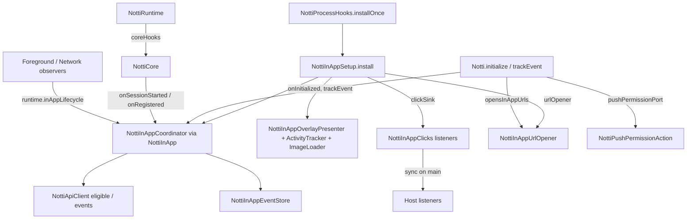

# In-App Messages Design

**Spec**: `.specs/features/in-app-messages/spec.md`
**Status**: Draft

---

## Architecture Overview

Port of RN 0.8.0's process-wide In-App engine. The coordinator stays a process singleton (`NottiInApp`), installed with the other process hooks; the facade only feeds it (initialize, `trackEvent`, options) and receives its clicks. The only behavior not in RN is the URL opener (AD-006), plugged in as a port next to the existing push-permission port.



## Key decisions

### D1: Engine owned by the process, installed with the hooks (spec decision 4)

- `NottiInAppSetup.install(application)` is ported and called from `NottiProcessHooks.installOnce`, where the placeholder comment is today (`NottiProcessHooks.kt:49`), inside its own `try/catch` that logs only the exception class (RN logged `t.message`). Provider and lazy `initialize` paths both get it (INAPP-08).
- `NottiInApp` (holder, `install/get/coreHooks/resetForTests`) is ported as is.
- `NottiRuntime` builds the core with `inApp = NottiInApp.coreHooks` instead of `NottiInAppHooks.None` (`NottiRuntime.kt:125`).
- `NottiRuntime.inAppLifecycle` defaults to a new internal `NottiInApp.lifecycle: NottiInAppLifecycle` forwarding each call to `NottiInApp.get()` (no-op when none installed). This closes the core-port deferral "onStop with no live core still ends the In-App session" (the observer reads it from the runtime, not the core).
- Setup's `logger = Log.w(NAME, …)` becomes `NottiLogger.warn(message)`; `NottiModule.PREFS_NAME` becomes the existing prefs constant.

### D2: Click delivery is synchronous on main

RN's sink is called inside the coordinator's main-thread block and returns whether someone got it, before `presenter.close`. `NottiListeners.dispatch` always posts, which would run listeners after the close and the URL open, and would make "delivered" unknowable at that point.

- `NottiListeners` gets `dispatchNow(value): Boolean`: calls each entry on the current thread, same per-entry `try/catch` and log line as `dispatch`, returns `true` when at least one entry was called. Only the In-App sink uses it, always from main.
- New internal `object NottiInAppClicks { val listeners; fun deliver(click: InAppClick): Boolean }` converts the internal `InAppClick` to the public `NottiInAppClick` and calls `dispatchNow`. Setup sets `coordinator.clickSink = InAppClickSink(NottiInAppClicks::deliver)` (RN default pointed at `NottiModule.emitInAppClick`).
- A listener added before `initialize` or before the engine exists is kept (the object outlives the coordinator).

### D3: URL opener (AD-006) as a third port

New file `NottiInAppUrlOpener.kt`, the only file the guard allowlists:

```kotlin
internal fun interface InAppUrlOpener { fun open(value: String): Boolean }

internal class NottiInAppUrlOpener(
    private val context: Context,                 // application context
    private val currentActivity: () -> Activity?, // NottiRuntime.currentActivity
) : InAppUrlOpener {
    @Volatile var enabled: Boolean = true
    fun accepts(value: String): Boolean            // http/https, host, no whitespace/control chars, pre-parse
    override fun open(value: String): Boolean      // true if startActivity was called
}
```

Coordinator change in `onDisplayClicked` (listed change to ported code):

1. `enqueue click` (unchanged).
2. `delivered = clickSink.deliver(...)` (unchanged, now synchronous host listeners, D2).
3. `opens = action?.type == URL && opener?.enabled == true && opener.accepts(action.value)` computed before the warn.
4. Warn when `!delivered && !runsPushPermission && !opens` (INAPP-11, iOS IOU-05).
5. `presenter.close` (unchanged).
6. If `opens`: `opener.open(value)`; failure logged inside the opener with one fixed line, no retry (INAPP-16).
7. `runPushPermission()` / `requestFlush()` (unchanged).

Refused value with the option on: one fixed `NottiLogger.debug("Notti.inapp: url action not opened")` (INAPP-14). Option off: nothing (INAPP-15). `deeplink`: never reaches the opener.

`open`: `Intent(ACTION_VIEW, Uri.parse(value)).addCategory(CATEGORY_BROWSABLE)`; from `currentActivity()` when present, else application context with `FLAG_ACTIVITY_NEW_TASK`; catches `Exception` and logs `"Notti.inapp: url open failed - ${class}"`.

### D4: Push-permission port wired by `Notti.initialize`

`NottiPushPermissionAction` ported unchanged. RN's `wirePushPermissionPort` moves to the facade (called on every `initialize`, as RN), with RN's lambdas mapped:

| RN | Here |
| --- | --- |
| `reactApplicationContext.currentActivity` | `runtime.currentActivity()` |
| `core.requestPermission { }` | `runtime.ensureCore().requestPermission { }` (goes through `NottiPermissionRequester`) |
| `deviceStore.getPermissionRequested()` | `runtime.deviceStore.getPermissionRequested()` |
| `Log.e(NAME, …)` | `NottiLogger.error` |
| `activity.startActivity(appNotificationSettingsIntent(...))` | same, in the facade wiring |

The settings intent uses `Settings` actions, not `ACTION_VIEW`, so it does not match the guard (spec decision 3).

### D5: Initialize order and the option

`Notti.initialize`, after `installOnce` and before `runtime.start` (RN `NottiModule.kt:213-225`):

1. `normalized = NottiCore.normalizeBaseUrl(baseUrl)`; if `appId`, `clientKey` not blank and `normalized != null`: `NottiInApp.get()?.onInitialized(appId, clientKey, normalized)` and `NottiInAppSetup.urlOpener?.enabled = options.opensInAppUrls` (every valid initialize applies the value it carries, also an identical config: no re-registration since the core's SDK-07 early return is untouched, INAPP-17).
2. Wire the push-permission port (D4).
3. `runtime.start(...)` (unchanged).

`NottiOptions` gains `val opensInAppUrls: Boolean = true` as the second `@JvmOverloads` parameter: the existing `(String?)` and `()` constructors stay, `(String?, Boolean)` is added (additive ABI).

### D6: Public types

| Type | Shape |
| --- | --- |
| `Notti.trackEvent(name: String)` | `@JvmStatic`; `NottiInApp.get()?.trackEvent(name)` inside `try/catch`; any thread (coordinator posts) |
| `Notti.InAppMessages` | nested `object`, `@JvmStatic fun addClickListener(listener: NottiInAppClickListener): NottiSubscription` |
| `NottiInAppClickListener` | `fun interface { fun onClick(click: NottiInAppClick) }` |
| `NottiInAppClick` | class, internal ctor, `messageId`, `buttonId`, `action: NottiInAppAction?`, `equals`/`hashCode`, `toString` prints `NottiInAppClick(buttonId=…, actionType=…)`, never `messageId` or the action value (URLs may carry PII) |
| `NottiInAppAction` | class, internal ctor, `type: NottiInAppAction.Type` (`URL`, `DEEPLINK`), `value: String`; `toString` prints the type only |

### D7: Port rules

- Every ported file starts with its provenance comment, is re-indented to 4 spaces, made `internal` (RN's public `NottiInAppAccessibility`, `InAppSiblingRestore`, `InAppTiming`, `NottiInAppScheduler`, presenter types become `internal`), `package com.zeeplabs.notti`.
- Listed changes per file only: Setup (D1 logger/prefs, opener, sink), Coordinator (D3 steps, default `clickSink = null` instead of `NottiModule.emitInAppClick`, `Log` → port logger already injected), others: package/visibility only. `scripts/port-diff.sh` proves it.
- Lint findings RN already has are suppressed per file.
- Tests ported 1:1 with the same `@Config(sdk = [34])` / `@GraphicsMode(NATIVE)`; RN `NottiModuleTest` In-App cases (wiring, emit payload, push-permission wiring) re-expressed as `NottiInAppFacadeTest` with the same scenarios.

### D8: Guard

`check-no-url-open.sh`: `ALLOWLIST=(notti/src/main/java/com/zeeplabs/notti/NottiInAppUrlOpener.kt)`; pattern adds `Intent\.parseUri`. Self-tests in `scripts/tests/` gain: an allowlisted file passes, an `ACTION_VIEW` elsewhere fails. Header documents that a text check cannot see every indirection (iOS M5).

## Code Reuse

| Component | Location | Use |
| --- | --- | --- |
| `NottiInAppModels`, `NottiInAppEventStore`, `NottiInAppHooks` | already ported | unchanged |
| `NottiApiClient.fetchEligibleInAppMessages` / `reportInAppEvent` | ported | unchanged |
| `NottiInAppLifecycle`, `runtime.inAppLifecycle` | core-port seam | D1 |
| `NottiListeners`, `NottiSubscription` | public-api | D2 (+`dispatchNow`) |
| `NottiRuntime.currentActivity`, `NottiPermissionRequester` | push-integration | D3, D4 |
| `NottiLogger` | core | all log lines |

## Tests

| Test class | Source | Count |
| --- | --- | --- |
| `NottiInAppCoordinatorTest` | RN port | 54 |
| `NottiInAppEndToEndTest` | RN port | 3 |
| `NottiInAppImageLoaderTest` | RN port | 20 |
| `NottiInAppPresenterTest` + `NottiInAppPresenterLifecycleTest` | RN port | 22 + 6 |
| `NottiInAppSessionTest` + `NottiInAppDisplayClockTest` | RN port | 44 + 6 |
| `NottiInAppStyleTest` | RN port | 19 |
| `NottiInAppViewFactoryTest` | RN port | 53 |
| `NottiPushPermissionActionTest` | RN port | 9 |
| `NottiInAppUrlOpenerTest` | new | accepts table, opens from Activity / app context, failure, disabled |
| Coordinator URL cases (new, in a separate `NottiInAppCoordinatorUrlTest` so the ported count stays exact) | new | order listeners→close→open, warn rule, deeplink, refused |
| `NottiInAppFacadeTest` | RN `NottiModuleTest` In-App cases + new | trackEvent, listener before init, payload, option on re-init, push-permission wiring |
| `NottiListenersTest` | +cases | `dispatchNow` |
| `NottiForegroundObserverTest` | deferred case | onStop with no core ends the In-App session |
| `NottiLogPrivacyTest` | +case | In-App flow at `VERBOSE` with a sentinel URL/event name |
| Java interop test | +calls | `trackEvent`, `addClickListener`, `NottiOptions(String, boolean)` |

## Risks

- **Coordinator change** (D3) is the only edit to ported logic; isolated in one block, covered by the new URL test class.
- **`dispatchNow`** runs host code inside the coordinator's main block: a slow listener delays the close. Same as RN (JS emit was synchronous on the bridge side) [Provável].
- **Image decompression bomb**: unchanged from RN (spec out of scope); cross-SDK todo in STATE.
- **`androidx.activity` 1.7.0** back-press APIs: present (`OnBackPressedCallback`); RN's resolved version unknown [Incerto], compiled and tested here.
