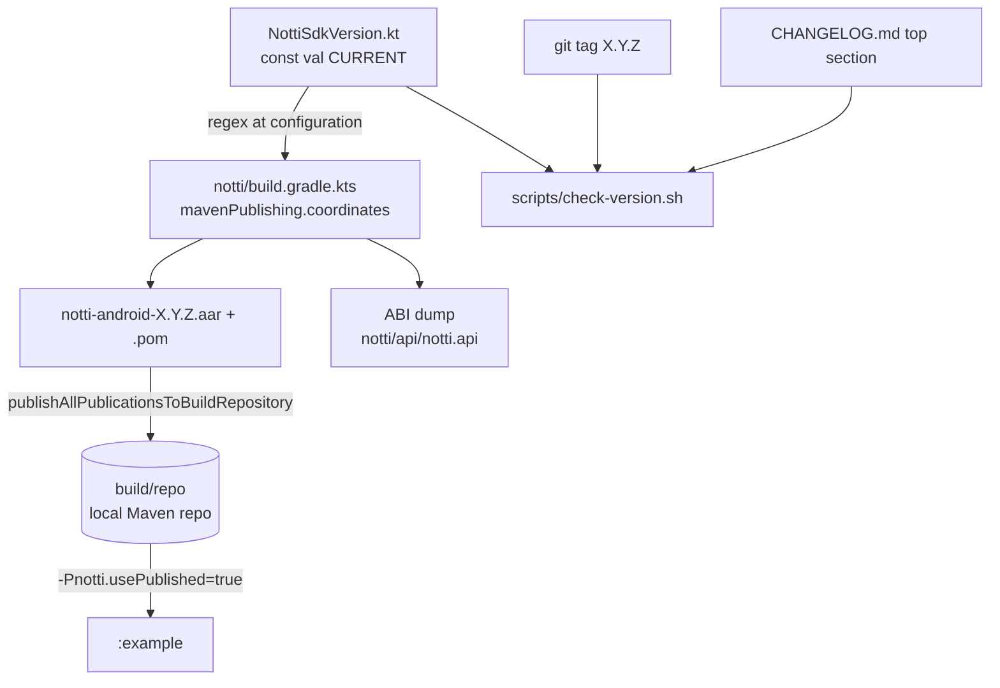

# Package Foundation Design

**Spec**: `.specs/features/package-foundation/spec.md`
**Status**: Approved (2026-10-28)

---

## Architecture Overview

One Gradle build, two modules. `:notti` is the SDK (Android library, AAR). `:example` is an app placeholder that, in CI, consumes `:notti` only through its published Maven coordinates, so the POM and the AAR are what is tested, not the project graph.



```
zeep-notti-android-sdk/
├── settings.gradle.kts          # :notti, :example; repositories (google, mavenCentral, build/repo when usePublished)
├── build.gradle.kts             # plugin declarations only (apply false)
├── gradle.properties            # android.useAndroidX, POM_* metadata, org.gradle.jvmargs
├── gradle/libs.versions.toml    # every version, one place
├── gradle/wrapper/              # wrapper validated in CI
├── notti/
│   ├── build.gradle.kts
│   ├── consumer-rules.pro       # shipped in the AAR (PKG-05)
│   ├── api/notti.api            # ABI dump (PKG-13)
│   └── src/
│       ├── main/AndroidManifest.xml               # no <application> attributes
│       ├── main/java/com/zeeplabs/notti/NottiSdkVersion.kt
│       └── test/java/com/zeeplabs/notti/          # version, Robolectric and org.json smoke tests
├── example/                      # placeholder app, one Activity, references a public SDK symbol
├── scripts/check-version.sh      # PKG-07
├── scripts/check-package-name.sh # PKG-04
├── .github/workflows/ci.yml
├── AGENTS.md, CLAUDE.md, CHANGELOG.md, LICENSE, README.md (stub)
└── .specs/codebase/TESTING.md
```

---

## Code Reuse Analysis

### Existing Components to Leverage

| Component | Location | How to Use |
| --- | --- | --- |
| RN library build | `../zeep-notti-react-native/android/build.gradle` | minSdk 24, compileSdk 36, Java 17, test dependency set (JUnit 4.13.2, MockWebServer/okhttp-tls 4.12.0, org.json 20240303, Robolectric 4.14.1) copied as-is for the port (AD-002) |
| RN runtime dependencies | RN `android/src/main` imports | Declared explicitly here because RN got some transitively from `react-android`: `firebase-messaging`, `lifecycle-process`, `androidx.core`, `androidx.activity`, `androidx.annotation`, `okhttp`. Versions = what the RN 0.8.0 example resolves (spike S1) |
| RN Robolectric usage | RN tests, `@Config(sdk = [32|33|34])` per class | Same pattern; no global `robolectric.properties` |
| iOS `check-version.sh` | `../zeep-notti-ios-sdk/scripts/check-version.sh` | Same contract: read constant, compare publication, top released CHANGELOG section and tag (`X.Y.Z`, no `v`, like iOS `0.1.0`); fail on any unreadable input |
| iOS CI | `../zeep-notti-ios-sdk/.github/workflows/ci.yml` | Same shape: actions pinned by SHA, `concurrency` cancel, `permissions: contents: read`, separate `checks` job for scripts |
| iOS AGENTS.md | `../zeep-notti-ios-sdk/AGENTS.md` | Same sections, Android content |

### Integration Points

| System | Integration Method |
| --- | --- |
| Firebase | `firebase-messaging` as `api` (public `RemoteMessage` in `NottiBridge`); the library never applies `com.google.gms.google-services`. `:example` applies it only when a `google-services.json` exists (RN example pattern) |
| Maven Central (later) | vanniktech `com.vanniktech.maven.publish` plugin with Central Portal; here only `publishAllPublicationsToBuildRepository` (local, no credentials). Signing configured but skipped when no key is present |
| RN M2 consumer | Spike S1 builds the RN 0.8.0 example against `build/repo` once, to prove an AAR built with this toolchain is consumable by RN's toolchain (Kotlin 2.1.20, Gradle 9.4.1) |

---

## Components

### Toolchain and version catalog

- **Purpose**: Pin every build input in `gradle/libs.versions.toml`.
- **Location**: `gradle/libs.versions.toml`, `gradle/wrapper/gradle-wrapper.properties`
- **Choice (primary)**: Gradle 9.4.1 (same as the RN 0.8.0 example), AGP 9.2.x with built-in Kotlin, Kotlin 2.2.x compiler with `languageVersion = apiVersion = 2.0` and `jvmTarget = 17`.
- **Fallback**: AGP 8.13.x + Kotlin Gradle plugin 2.0.21 (RN library baseline) + standalone Binary Compatibility Validator.
- **Decision rule**: spike S1 must pass every check below with the primary; any failure switches to the fallback and is recorded as an AD.
- **Why not just copy RN's AGP 8.7.2 / Kotlin 2.0.21**: RN's library build inherits the host's AGP; this repo owns its toolchain for years and AGP 9 is the stable line since January 2026. `apiVersion 2.0` keeps the AAR readable by hosts on Kotlin 2.0+ [Provável; S1 proves it with RN's Kotlin 2.1.20].

### `:notti` library module

- **Purpose**: The SDK AAR.
- **Location**: `notti/build.gradle.kts`
- **Interfaces**:
  - `android { namespace = "com.zeeplabs.notti"; compileSdk = 36; defaultConfig { minSdk = 24; consumerProguardFiles("consumer-rules.pro") } }`
  - `compileOptions` Java 17; `testOptions.unitTests.isIncludeAndroidResources = true` (Robolectric)
  - `lint { warningsAsErrors = true; abortOnError = true; checkDependencies = false }` plus a `lint-baseline.xml` only if ported RN code needs it (AD-009)
  - `buildFeatures.buildConfig = false` (version comes from Kotlin, not `BuildConfig`)
  - `mavenPublishing { coordinates("com.zeeplabs", "notti-android", nottiVersion); configure(AndroidSingleVariantLibrary("release", sourcesJar = true, publishJavadocJar = true)); pom { … } ; signAllPublications() only when a key is set }`
  - repository `build` → `rootProject.layout.buildDirectory.dir("repo")`
- **Dependencies (main)**: `api(firebase-messaging)`, `implementation(lifecycle-process, androidx-core, androidx-activity, androidx-annotation, okhttp)`. Declared now so the POM is reviewed once; unused until `core-port` (Android Lint `UnusedDependency` is not a default check, so no warning).
- **Dependencies (test)**: JUnit 4.13.2, MockWebServer 4.12.0, okhttp-tls 4.12.0, org.json 20240303, Robolectric 4.14.1 (RN set, AD-002).
- **Reuses**: RN `android/build.gradle`.

### Version source (PKG-06)

- **Purpose**: One literal for the SDK version.
- **Location**: `notti/src/main/java/com/zeeplabs/notti/NottiSdkVersion.kt`

```kotlin
package com.zeeplabs.notti

internal object NottiSdkVersion {
    const val CURRENT = "0.1.0"
}
```

- **Gradle read**: `notti/build.gradle.kts` reads the file with `Regex("""const val CURRENT = "([^"]+)"""")` at configuration; zero or more than one match throws `GradleException`, so a build cannot publish a version different from the constant. `internal` because the public accessor shape belongs to `public-api`; the ABI dump stays empty here.
- **Starting value**: `0.1.0` (Julio, 2026-10-28). Nothing is published in this feature; CHANGELOG keeps it under `[Unreleased]` until release day, so the tag/date gate of `check-version.sh` stays closed.

### `scripts/check-version.sh` (PKG-07)

- Reads the constant (same regex, `sed -nE`), fails if the file or the match is missing.
- Reads the top released `## [x.y.z] - YYYY-MM-DD|TBD` section of `CHANGELOG.md` (skipping `[Unreleased]`); when one exists it must equal the constant (iOS EXR-21 rule). With only `[Unreleased]`, passes.
- With `GITHUB_REF=refs/tags/X.Y.Z`: tag must equal the constant and the CHANGELOG section must have a real date.
- Bash, `set -euo pipefail`, portable `sed -E` (GNU and BSD), tested by `scripts/tests/check-version-test.sh` with fixture dirs (missing file, drift, tag mismatch, ok) run in CI (lessons L-002, L-007).

### `scripts/check-package-name.sh` (PKG-04)

- Fails if any `*.kt`/`*.java` under `notti/src` or `example/src` declares `package com.notti` or `package com.notti.<x>`, or imports `com.notti.`; also fails if `namespace` in `notti/build.gradle.kts` is not `com.zeeplabs.notti`. Uses `grep -rE '^(package|import) com\.notti(\.|$|\s)'`, distinguishing exit 1 (no match, pass) from exit 2 (error, fail). Has a negative fixture test like `check-version.sh`.

### Library manifest and consumer rules (PKG-05)

- `notti/src/main/AndroidManifest.xml`: `<manifest xmlns:android=…/>` with nothing else now. `POST_NOTIFICATIONS`, the FCM service and the provider come with `push-integration`.
- `consumer-rules.pro`: a header comment only (keep rules come with the components). The CI step `unzip -l notti-release.aar | grep proguard.txt` proves AGP packages it (AGP renames the consumer file to `proguard.txt` inside the AAR [Provável; S1 confirms]).

### ABI guard (PKG-13, AD-010)

- **Primary**: Kotlin Gradle plugin built-in ABI validation (Kotlin 2.2+), dump at `notti/api/notti.api`, check wired into `check`. It is marked experimental by JetBrains; the task names differ across 2.2.x docs (`checkLegacyAbi` / `checkKotlinAbi`), so S1 records the exact names for the pinned Kotlin version in `TESTING.md`.
- **Fallback**: standalone `org.jetbrains.kotlinx.binary-compatibility-validator` (frozen, still recommended by JetBrains for production until the KGP API stabilizes), `apiDump`/`apiCheck`.
- Either way: dump committed, CI runs the check, AGENTS.md documents the update command.

### Lint

- **Kotlin style**: Spotless with ktlint (official Kotlin style, 4 spaces), `spotlessCheck` in CI. Chosen over `org.jlleitschuh.gradle.ktlint` because Spotless is the more actively maintained wrapper [Provável]; S1 confirms it runs with the chosen AGP/Kotlin.
- **Android Lint**: `:notti:lintRelease` with `warningsAsErrors` (PKG-10, named in the `build` job).
- Detekt: not in M1 (the port would need a large baseline for little gain).

### `:example` placeholder (PKG-03)

- App module, `applicationId = "com.zeeplabs.notti.example"`, one Activity that touches a symbol of the SDK so the dependency is exercised at compile time. Since `NottiSdkVersion` is `internal`, the placeholder references a trivial `public` marker only if S1 shows a dependency with no referenced symbol is not enough proof; otherwise it just compiles with the dependency on the classpath and the CI also checks the resolved POM dependency list (`:example:dependencies --configuration releaseRuntimeClasspath | grep com.zeeplabs:notti-android`).
- `settings.gradle.kts` reads `notti.usePublished` (default `false`): `false` → `implementation(project(":notti"))` for local dev; `true` → `implementation("com.zeeplabs:notti-android:<constant>")` from `build/repo`. CI runs publish and example in two separate Gradle invocations so resolution happens after the repo is filled.

### CI (`.github/workflows/ci.yml`, PKG-09..12)

| Job | Runner | Steps |
| --- | --- | --- |
| `checks` | `ubuntu-24.04` | checkout; `scripts/check-version.sh`; `scripts/check-package-name.sh`; script self-tests |
| `build` | `ubuntu-24.04` | checkout; `gradle/actions/wrapper-validation`; `actions/setup-java` (temurin 17); `gradle/actions/setup-gradle` (cache); `./gradlew spotlessCheck :notti:lintRelease :notti:testDebugUnitTest :notti:<abiCheck> :notti:assembleRelease :notti:publishAllPublicationsToBuildRepository`; AAR content check (`proguard.txt`, `AndroidManifest.xml`, no `com/notti/` entry in `classes.jar`); POM check (groupId/artifactId/version, no `com.facebook.react`); `./gradlew -Pnotti.usePublished=true :example:assembleDebug` |

- Triggers: `pull_request`, `push` to `main`, tags `*`. `permissions: contents: read`. Actions pinned by commit SHA with the version in a comment (iOS rule). No `continue-on-error`.
- Unit tests run the `debug` variant (`testDebugUnitTest`): RN CI runs the same; release unit tests add nothing without minification in tests.
- Test reports uploaded as an artifact on failure.

### Smoke tests (PKG-08, PKG-11)

| Test | Location | Proves |
| --- | --- | --- |
| `NottiSdkVersionTest` | `notti/src/test/.../NottiSdkVersionTest.kt` | constant matches `^\d+\.\d+\.\d+(-[0-9A-Za-z.-]+)?$` |
| `RobolectricSmokeTest` | same dir | `@RunWith(RobolectricTestRunner::class) @Config(sdk = [34])`, builds an `android.os.Bundle`, reads it back (fails without Robolectric: the JVM stub throws) |
| `OrgJsonSmokeTest` | same dir | plain JUnit, `JSONObject("{\"a\":1}").getInt("a") == 1` (fails with the android.jar stub) |

---

## Spike S1 (first task, throwaway branch, results go to STATE.md as an AD)

1. Primary toolchain builds `:notti` and `:example`, runs the three smoke tests on JDK 17.
2. ABI validation: record task names, dump format for an Android library, and that adding a `public` class fails the check.
3. Spotless + ktlint runs.
4. vanniktech publish to `build/repo`: POM content, sources and javadoc jars present, signing skipped without a key.
5. AAR contains `proguard.txt`.
6. Consumer proof: point the RN 0.8.0 example (`../zeep-notti-react-native/example/android`, Kotlin 2.1.20, Gradle 9.4.1) at `build/repo` in a scratch copy, add the dependency, `assembleDebug` succeeds. No change committed to the RN repo.
7. Record the resolved versions of `firebase-messaging`, `lifecycle-process`, `androidx.core`, `androidx.activity`, `okhttp` in the RN example (`:app:dependencies`) and pin them in the catalog.

Any failure in 1-6 → fallback toolchain, re-run, AD records why.

---

## Error Handling Strategy

| Error Scenario | Handling | Impact |
| --- | --- | --- |
| `NottiSdkVersion.kt` missing or regex matches 0 or 2+ times | `GradleException` at configuration; script exits 1 | Build/CI red with a clear message |
| Tag build with tag ≠ constant or undated CHANGELOG | `check-version.sh` exits 1 | Release blocked |
| `grep` error (unreadable dir) in package scan | exit 2 → script fails | CI red, not a false pass |
| No signing key (PRs, forks) | signing skipped, local publish still runs | None; Central publish is a separate, later job |
| `google-services.json` absent in `:example` | plugin not applied | Example builds; no push until the integrator adds it |

---

## Tech Decisions

| Decision | Choice | Rationale |
| --- | --- | --- |
| Toolchain | AGP 9.2 + Gradle 9.4.1 + Kotlin 2.2 (`apiVersion 2.0`), fallback AGP 8.13 + Kotlin 2.0.21 | Current stable line; Gradle version already proven by the RN example; spike-gated |
| Publish plugin | vanniktech `maven.publish` (0.35.x [Provável], pin after S1) | Native Central Portal support; raw `maven-publish` has no Portal upload |
| Version source | Kotlin `const val`, Gradle reads it | One literal; drift impossible by construction, the script covers tag and CHANGELOG |
| Tag format | `X.Y.Z` (no `v`) | Same as the iOS SDK |
| Firebase scope | `api` | `RemoteMessage` in the public `NottiBridge` |
| OkHttp | `implementation` 4.12.0 line | RN core uses OkHttp 4 APIs; OkHttp 5 hosts: to check in S1 [Incerto] |
| ABI guard | KGP built-in, fallback BCV | AD-010; BCV standalone is frozen |
| Kotlin style | Spotless + ktlint official | 4 spaces (AD-009) |
| Example consumption | published coordinates in CI, project dependency locally | PKG-03 tests the POM, dev stays fast |

---

## Spike S1 outcome (2026-10-28)

Primary toolchain confirmed; see STATE AD-012 for pinned versions and the BCV manual wiring (KGP ABI validation and BCV auto-wiring do not work with AGP built-in Kotlin). Runtime dependency versions: AD-013. Reusable build files: scratchpad `spike-s1/`.

## Owner decisions (Julio, 2026-10-28)

- Starting version `0.1.0`.
- MIT license.
- Toolchain: primary (AGP 9.2 + Gradle 9.4.1 + Kotlin 2.2, `apiVersion 2.0`), gated by spike S1; fallback only if S1 fails. Rationale: RN's declared AGP 8.7.2 / Kotlin 2.0.21 never ran in practice (the host's root classpath wins; the RN example builds the module with Gradle 9.4.1 and Kotlin 2.1.20), so copying it is not lower risk.

## Sources

- AGP 9.0/9.2 release notes (minimum Gradle, built-in Kotlin): https://developer.android.com/build/releases/agp-9-0-0-release-notes, https://developer.android.com/studio/releases/gradle-plugin
- Kotlin ABI validation in KGP: https://kotlinlang.org/docs/gradle-binary-compatibility-validation.html
- vanniktech plugin changelog (Central Portal): https://vanniktech.github.io/gradle-maven-publish-plugin/changelog
