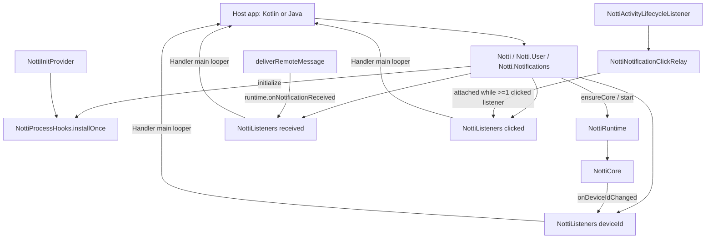

# Public API Design

**Spec**: `.specs/features/public-api/spec.md`
**Status**: Approved (Julio, 2026-10-30)

---

## Architecture Overview

A thin public facade (`Notti`) over the existing `NottiRuntime`. The facade owns only what the spec gives it (AD-008): listener multiplexing, main-thread delivery, the default `baseUrl`, the log level, and installing the process hooks when the provider did not. Everything else is a one-line delegation to `NottiCore`, as `NottiModule` did in RN 0.8.0.

## Key decisions

### D1: One core per runtime, re-initialized in place (RN), not rebuilt (iOS)

`NottiCore.initialize` already implements the spec rule (API-02): identical `appId`/`clientKey`/normalized `baseUrl` returns early (SDK-07), a different config swaps the API client and registers again, with the token-callback race handled (L2). RN 0.8.0 used exactly this on one lazy core. Rebuilding the core (iOS) would add executor hand-off and in-flight-mutation questions for no observable gain: the spec's outcome (0 extra registrations for the same config, 1 for a different one) is the same. API-02 AC3 is reworded to the outcome; the parity table is corrected (RN did **not** re-register on an identical call in the same process; the earlier note confused it with one `POST /devices` per process start).

Consequences for `NottiRuntime`:

- New `ensureCore(): NottiCore` (synchronized): returns the live core or builds one with the same wiring `start` uses today, **without** calling `initialize` (RN's lazy core). `NottiForegroundObserver.onCoreCreated` runs here, once per core.
- `start(appId, clientKey, baseUrl, …)` becomes `ensureCore().also { it.initialize(appId, clientKey, baseUrl, NottiSdkVersion.CURRENT) }`. Its `permissionRequester` / `onDeviceIdChanged` parameters move to constructor-level hooks of the runtime (see D3) so that `ensureCore` and `start` build the same core.
- `NottiRuntimeTest` "a second start replaces the core" is rewritten to the new contract (second `start` returns the same core; different config re-registers). Count kept.

### D2: Process hooks extracted to `NottiProcessHooks.installOnce(application)`

The body of `NottiInitProvider.onCreate` (lifecycle listener, runtime seed, network observer, foreground observer posted to main) moves to an internal object guarded by an `AtomicBoolean`. The provider calls it; `Notti.initialize` calls it too (API-13). The provider file keeps its provenance header; the move is a listed change (the code is unchanged, only relocated). `NottiActivityLifecycleListener.registerOnce` keeps its own guard.

Late install (provider removed, `initialize` in the launch Activity's `onCreate`): the tap is caught by `onActivityResumed`. To honor the spec edge case, `handle` on the resumed path also skips an intent with `FLAG_ACTIVITY_LAUNCHED_FROM_HISTORY`. A process restore cannot be detected on resume (`savedInstanceState` is only passed to `onCreate`); documented as a README limitation for the provider-removed setup.

**Finding (inherited RN bug, [Provável])**: with the provider present, `onActivityCreated` skips a restore/Recents intent but does not record it in `handledIntents`, so the `onActivityResumed` that follows handles the same intent and reports a phantom `opened` + `clicked`. RN's tests call only `onActivityCreated`, so they do not see it. Out of scope here (AD-002 port rule); recorded in STATE as a todo to prove with a created+resumed test and fix in both repos. The resumed-path history check above does not fix the restore case.

### D3: Runtime-level event slots, facade-level fan-out

The runtime keeps one slot per event, as now: `onNotificationReceived` (exists) and a new `onDeviceIdChanged: ((String) -> Unit)?` read by the core's callback (`onDeviceIdChanged = { id -> this.onDeviceIdChanged?.invoke(id) }`). Clicks keep the relay. The facade installs its fan-out into these slots on first use; the slots stay single so the RN M2 bridge or tests can still read them.

`NottiListeners<T>` (internal, new):

- `CopyOnWriteArrayList` of entries; `add(listener): NottiSubscription`, `dispatch(value)`.
- `dispatch` snapshots the list and posts one `Runnable` to the main `Handler`; the runnable calls each entry still registered at run time, in order, each in its own `try/catch` that logs `listener failed - ${t.javaClass.simpleName}` (API-10 AC7). Adding/removing inside a callback is safe (copy-on-write) and applies to the next event (AC4).
- Always posts, also when already on main: keeps emission order equal to delivery order and avoids reentrancy (spec edge case).
- `onFirstAdded` / `onLastRemoved` hooks: for clicks they `attach`/`detach` the relay emitter (API-11 AC3); for received/deviceId they set/clear the runtime slot.
- `NottiSubscription.remove()` removes its entry and nulls its listener reference; idempotent through an `AtomicBoolean`.

### D4: Main-thread delivery of the permission callback

`requestPermission(callback)` wraps the callback once: `core.requestPermission { granted -> main.post { callback.onResult(granted) } }`. Before initialize the core answers `false` synchronously; the wrapper still posts, so the host sees one thread rule.

### D5: Public types designed for ABI stability and Java

| Type | Shape | Why |
| --- | --- | --- |
| `Notti` | `object`; nested `object User`, `object Notifications`; every member `@JvmStatic`; `logLevel` as `@JvmStatic var` (Java `Notti.getLogLevel()/setLogLevel()`) and `deviceId` as `@JvmStatic val` | Kotlin `Notti.User.addTag`, Java `Notti.User.addTag` |
| `NottiOptions` | `class NottiOptions @JvmOverloads constructor(val baseUrl: String? = null)` | Later fields (AD-006 flag) are added as new defaulted params: additive overloads, no `copy`/`componentN` |
| `NottiNotification` | `class` with `internal constructor`, `val title: String?`, `val body: String?`, `val data: Map<String, String>`; `equals`/`hashCode`; `toString` prints keys only | Hosts never build it; PII-safe `toString` |
| `NottiLogLevel` | `enum class NONE, ERROR, WARN, INFO, DEBUG, VERBOSE` mapped by a `when` to `NottiLogger.Level` | No internal type in public signatures |
| `NottiSubscription` | `class` with `internal constructor`, `fun remove()` | |
| Listeners | `fun interface NottiNotificationListener { fun onNotification(notification: NottiNotification) }`, `fun interface NottiDeviceIdListener { fun onDeviceIdChanged(deviceId: String) }`, `fun interface NottiPermissionCallback { fun onResult(granted: Boolean) }` | SAM: Kotlin lambdas and Java lambdas both work; Kotlin `(T) -> Unit` would expose `Function1` and `Unit` to Java |

`NottiLogger.Level` already has the same six values (`NONE` silences), so the mapping is one-to-one (verified in `NottiLogger.kt`).

## Facade method map

| Public | Delegation | Spec |
| --- | --- | --- |
| `Notti.initialize(context, appId, clientKey, options = NottiOptions())` | `app = context.applicationContext ?: context`; `NottiProcessHooks.installOnce(app as Application)`; `NottiRuntime.get(app).start(appId, clientKey, options.baseUrl ?: DEFAULT_BASE_URL)`; the core validates and logs | API-01..03, API-13 |
| `Notti.login(id)` / `logout()` | `runtimeOrWarn()?.ensureCore()?.login(id)` / `.logout()` | API-04 |
| `Notti.deviceId` | `NottiRuntime.peek()?.deviceStore?.getDeviceId()` (no core needed) | API-05 |
| `Notti.addDeviceIdChangedListener(l)` | `deviceIdListeners.add(l)` | API-05, API-11 |
| `Notti.setSubscription(b)` | `ensureCore().setSubscription(b)` | API-08 |
| `Notti.setLocationSharingEnabled(b)` | `ensureCore().setLocationSharingEnabled(b)` on the caller's thread | API-08 |
| `Notti.logLevel` | `NottiLogger.level` mapped | API-15 |
| `Notti.User.addTag(k, v)` / `addTags(map)` | `mutateTags(add = map, remove = null)` | API-06 |
| `Notti.User.removeTag(k)` / `removeTags(keys)` | `mutateTags(add = null, remove = keys)` | API-06 |
| `Notti.User.setEmail/clearEmail/setPhone/clearPhone` | same-name core calls | API-07 |
| `Notti.Notifications.requestPermission(cb)` | D4; with no runtime: posts `false` | API-09 |
| `Notti.Notifications.addReceivedListener(l)` / `addClickedListener(l)` | D3 | API-10, API-11 |
| `Notti.Notifications.takeInitialClick()` | `NottiNotificationClickRelay.takePending()?.toPublic()` | API-12 |

`runtimeOrWarn()` returns `NottiRuntime.peek()` or logs `NottiLogger.warn("Notti.<method>: called before initialize with no runtime - dropped")` (method name only, no values).

## Code Reuse

| Component | Location | Use |
| --- | --- | --- |
| `NottiCore` public-ish methods | `NottiCore.kt` | Unchanged; every facade call delegates |
| `NottiRuntime` | `NottiRuntime.kt` | Add `ensureCore`, `onDeviceIdChanged` slot; `start` built on `ensureCore` |
| `NottiNotificationClickRelay` | unchanged | `attach`/`detach`/`takePending` |
| `deliverRemoteMessage` | `NottiFirebaseMessagingService.kt` | Already calls `runtime.onNotificationReceived` |
| `NottiLogger` | unchanged | Level mapping; warn lines |
| `NottiInitProvider.onCreate` body | moved to `NottiProcessHooks` | D2 |
| Log privacy sentinel test | `NottiLogPrivacyTest.kt` | Add a facade flow at `VERBOSE` (API-15) |

## Tests (new, JUnit 4 + Robolectric)

- `NottiFacadeTest`: initialize (default baseUrl, blank values, invalid URL, same and different config, background thread), login/logout, profile calls before/after initialize, `notti_prefs` on the production path (API-01..08).
- `NottiListenersTest`: fan-out order, main looper, remove/idempotent remove, add/remove inside a callback, throwing listener isolation, relay attach/detach, initial click once (API-10..12).
- `NottiPermissionFacadeTest`: callback on main, before initialize `false`, two concurrent requests (API-09).
- `NottiProcessHooksTest`: install once from provider and from `initialize`; no double registration; late tap on resume with and without the history flag (API-13).
- `NottiJavaInteropTest.java`: calls every public method with Java lambdas (API-14).
- `NottiLogPrivacyTest`: new case through the facade at `VERBOSE` (API-15).
- `apiDump` updated and reviewed (API-14).

## Risks

- **Core re-init vs iOS rebuild** (D1): a behavior difference between the native SDKs only in timing of internal objects; same observable registrations. Recorded as AD-014.
- **Resumed-path history check** (D2) is a small change to ported code; it only adds a skip and is covered by a new test. RN restore bug stays until fixed in both repos.
- **`Application` cast**: `applicationContext` is an `Application` in every real app; if not (exotic test contexts), hooks are skipped with an error line and the rest still works.
