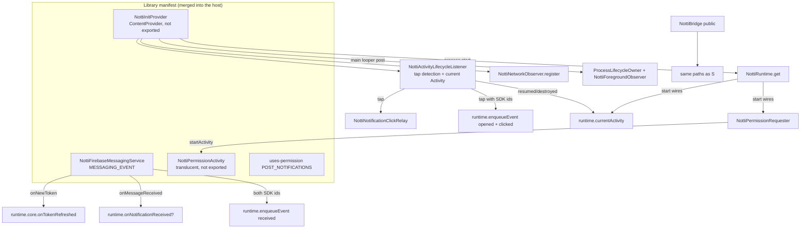

# Push Integration Design

**Spec**: `.specs/features/push-integration/spec.md`
**Status**: Draft (2026-10-29)
**Depends on**: `core-port` (`NottiRuntime`, `NottiAndroidProviders`, observers, `NottiLogger`)

---

## Architecture Overview

Port the five RN integration files onto `NottiRuntime`, add the two pieces RN got from React Native (current Activity, permission dialog host), and declare everything in the library manifest.



---

## Code Reuse Analysis

| Component | RN source (tag `v0.8.0`) | How |
| --- | --- | --- |
| `ParsedNotification`, `parseRemoteMessage`, `NottiFirebaseMessagingService` | `NottiFirebaseMessagingService.kt` | Port; `toWritableMap` dropped; `NottiModule.*` → runtime |
| `NottiNotificationClickRelay` | `NottiNotificationClickRelay.kt` | Port unchanged (it has no RN symbol) |
| `parseClickIntentExtras`, `NottiActivityLifecycleListener` | `NottiActivityLifecycleListener.kt` | Port; `NottiModule.enqueueEvent` → runtime; plus the current-Activity tracking (new lines, below) |
| `NottiInitProvider` | `NottiInitProvider.kt` lines 1-100 (the observer part already came in core-port) | Port; `NottiModule.getEventStore(app)` → `NottiRuntime.get(app)`; In-App install line left for `in-app-messages` |
| `NottiBridge` | `NottiBridge.kt` | Port; becomes the first `public` API |
| Permission request | `NottiModule.requestNativePermission` | Replaced: RN's `PermissionAwareActivity` is React Native only (see below) |
| Tests | `NottiActivityLifecycleListenerTest` (20), `NottiFirebaseMessagingServiceTest` (6), `NottiBridgeTest` (2), `NottiModuleTest` "requestPermission on Android below 13 …" (1) | Port; statics → `NottiRuntime.resetForTest()` |
| Process | iOS `delegate-integration` (manual API, no-URL-open guard) | Same shape |

Allowed changes in ported files: the `core-port` list (header, package, `internal`, reindent, logger rule 5, statics → runtime, KDoc), plus: `NottiModule.emitNotificationReceived(remoteMessage)` → `runtime.onNotificationReceived?.invoke(parseRemoteMessage(remoteMessage))`; `NottiModule.activeCore` → `NottiRuntime.peek()?.core`; `NottiBridge` stays `public`.

---

## Components

### NottiFirebaseMessagingService (port)

- `onNewToken(token)`: `NottiRuntime.peek()?.core?.onTokenRefreshed(token)` (RN: `activeCore?.…`; no core → dropped, PUSH-02).
- `onMessageReceived(message)`: `val runtime = NottiRuntime.get(applicationContext)`; `runtime.onNotificationReceived?.invoke(parsed)`; both ids non-blank → `runtime.enqueueEvent(…, NottiEventType.RECEIVED)`.
- `NottiRuntime` gains `@Volatile var onNotificationReceived: ((ParsedNotification) -> Unit)? = null` (set by `public-api`; RN emitted only to a live module, no buffer).

### NottiNotificationClickRelay (port, unchanged)

`emit`, `attach`, `takePending`, `detach` (identity-guarded), `reset` for tests. `public-api` attaches its listener multiplexer and implements `getInitialNotificationClick` with `takePending`.

### NottiActivityLifecycleListener (port + current Activity)

- RN body unchanged except `NottiModule.enqueueEvent` → `NottiRuntime.get(activity.applicationContext).enqueueEvent`.
- New: `onActivityResumed` also sets `runtime.currentActivityRef = WeakReference(activity)`; `onActivityDestroyed` clears it when it is the same Activity. `NottiRuntime.currentActivity` (already `() -> Activity?`) reads the reference. This is what RN's `ReactContext.currentActivity` provided.
- `registerOnce(application)` unchanged.

### NottiPermissionActivity + NottiPermissionRequester (new)

- **Why**: RN asked through `PermissionAwareActivity`, an RN-only interface. The SDK cannot rely on the host Activity's type.
- **Choice**: a translucent, not exported `NottiPermissionActivity` declared in the library manifest (OneSignal's `PermissionsActivity` model). Rejected: `ActivityResultRegistry.register` on the host's `ComponentActivity` (fails for a plain `Activity` host, and the result is lost if the host is recreated while the dialog is up unless the key is re-registered).
- **Flow** (`NottiPermissionRequester.request(callback)`):
  1. API < 33 → `callback(true)`, no Activity touched (RN; PUSH-16).
  2. No current Activity → `callback(false)` (RN; PUSH-18).
  3. `deviceStore.setPermissionRequested(true)` (RN, before the dialog); register `callback` under a new id in a process-wide `ConcurrentHashMap<Int, (Boolean) -> Unit>`; `currentActivity.startActivity(Intent(…, NottiPermissionActivity).putExtra(id))` with no animation.
  4. `NottiPermissionActivity.onCreate`: `requestPermissions(arrayOf(POST_NOTIFICATIONS), id)`; `onRequestPermissionsResult`: `remove(id)?.invoke(granted)`, `finish()` with no animation. Missing id or a recreated Activity (saved state) whose request already ran: finish without asking again.
  5. Each id resolves exactly once (`remove` returns the callback once); an Activity destroyed without a result (e.g. process death) leaves no callback to call, and a later request works normally.
- **Theme**: `@android:style/Theme.Translucent.NoTitleBar`, `excludeFromRecents`, `noHistory`, `exported="false"`, `taskAffinity` of the host (default).

### NottiRuntime changes

- `currentActivity` backed by the lifecycle listener's weak reference (no longer a test-only lambda default).
- `start(…)` defaults `permissionRequester` to `NottiPermissionRequester(…)::request` instead of `{ it(false) }`; providers already read `currentActivity` → `permission_status` regains RN parity (PUSH-19, closes the core-port accepted exception).
- New field `onNotificationReceived`.

### NottiInitProvider (port)

- `onCreate`: `application` from `context`; `NottiRuntime.get(application)`; `NottiActivityLifecycleListener.registerOnce(application)`; `NottiNetworkObserver(connectivityManager).register()`; main-looper post adding `NottiForegroundObserver` to `ProcessLifecycleOwner`; each step in its own `try`, failures logged by exception class (AD-011), return `true`.
- **Authority**: `${applicationId}.com.zeeplabs.notti.initprovider` (RN: `${applicationId}.nottiinitprovider`; distinct names avoid `INSTALL_FAILED_CONFLICTING_PROVIDER` while both are present). `initOrder="100"` as RN.
- `ContentProvider` kept over `androidx.startup` (AD-005 confirmed here): no new dependency, same timing as RN, removable with `tools:node="remove"`.

### NottiBridge (port, public)

```kotlin
public object NottiBridge {
    @JvmStatic public fun onMessageReceived(remoteMessage: RemoteMessage)
    @JvmStatic public fun onNewToken(token: String)
}
```

Same bodies as the service (shared internal functions so both paths are one code path). Needs an application `Context` for `NottiRuntime.get`: `onMessageReceived` uses `NottiRuntime.peek()` and, with no runtime, does nothing beyond what RN did (RN was a no-op with no module). First public symbols: `notti/api/notti.api` updated in the same commit (AD-010). Naming may be revisited by `public-api` before 0.1.0 (nothing is published).

### Library manifest

```xml
<uses-permission android:name="android.permission.POST_NOTIFICATIONS" />
<application>
  <provider android:name=".NottiInitProvider" android:authorities="${applicationId}.com.zeeplabs.notti.initprovider" android:exported="false" android:initOrder="100" />
  <service android:name=".NottiFirebaseMessagingService" android:exported="false">
    <intent-filter><action android:name="com.google.firebase.MESSAGING_EVENT" /></intent-filter>
  </service>
  <activity android:name=".NottiPermissionActivity" android:exported="false" android:excludeFromRecents="true" android:noHistory="true" android:theme="@android:style/Theme.Translucent.NoTitleBar" />
</application>
```

No `<application>` attributes (PKG-05 still holds). Consumer R8 rules: AGP keeps manifest-declared components automatically (aapt rules) [Provável]; T9 proves it with a minified release build of `:example` and keeps `consumer-rules.pro` comment-only if so.

### Manual FCM proof module (PUSH-15)

`:example-manual-fcm` (app, not published): its manifest removes `NottiFirebaseMessagingService` with `tools:node="remove"` and declares its own `FirebaseMessagingService` forwarding to `NottiBridge`. CI assembles it and asserts the merged manifest has its service and not ours.

### URL-open guard (PUSH-12)

`scripts/check-no-url-open.sh`: fails on `Intent.ACTION_VIEW`, `ACTION_VIEW`, `CustomTabsIntent`, `Uri.parse(` combined with `startActivity`, and `openUri` under `notti/src/main`, except an allowlist by exact path (empty now; `in-app-messages` adds the push-permission settings file and the AD-006 URL opener). grep exit 2 fails. Self-test.

---

## Error Handling Strategy

| Error Scenario | Handling | Impact |
| --- | --- | --- |
| Provider step throws | Logged by class, next step still runs | Partial hooks, no host crash |
| No core at `onNewToken` | Dropped (RN) | Next `initialize` fetches the token |
| No runtime in `NottiBridge.onMessageReceived` | No-op (RN with no module) | Host without our provider and before `initialize` loses that `received` (documented) |
| `startActivity` for the permission Activity throws | `remove(id)?.invoke(false)` | `requestPermission` resolves false |
| Permission Activity killed before the result | Callback never invoked; entry stays until process death | Same as RN when the host died mid-dialog |

---

## Testing Strategy

- Ported: 20 + 6 + 2 + 1 tests (names unchanged; statics → `NottiRuntime.resetForTest()`).
- New: `NottiPermissionRequesterTest` (Robolectric API 32/34: below 33 true; no Activity false; granted/denied via `ShadowActivity`/`ShadowApplication` permission results; two concurrent requests resolve once each; flag set before the dialog; `startActivity` failure resolves false), `NottiCurrentActivityTest` (resumed sets, destroyed clears, other Activity destroyed keeps, no leak with `WeakReference`), `NottiInitProviderTest` (each registration, runtime created, no request to MockWebServer, a throwing step does not stop the others), `NottiManifestTest` (Robolectric `PackageManager`: service with `MESSAGING_EVENT` not exported, provider authority and not exported, activity not exported, `POST_NOTIFICATIONS` requested), runtime test that `permission_status` is sent on API 34 with a resumed Activity.
- CI: `check-no-url-open.sh`, `:example-manual-fcm:assembleDebug` + merged-manifest grep, minified `:example` release build.

---

## Tech Decisions

| Decision | Choice | Rationale |
| --- | --- | --- |
| Process hook | `ContentProvider` | Port; no dependency; AD-005 |
| Authority | `${applicationId}.com.zeeplabs.notti.initprovider` | Cannot collide with RN 0.8.0 |
| Permission dialog host | SDK translucent Activity | Works with any host Activity; survives host recreation |
| Current Activity | Weak reference set on resume, cleared on destroy | RN `ReactContext.currentActivity` semantics |
| Received delivery | Runtime callback, no buffer | RN semantics |
| `NottiBridge` visibility | `public`, `@JvmStatic` | Java hosts; first ABI entries |
